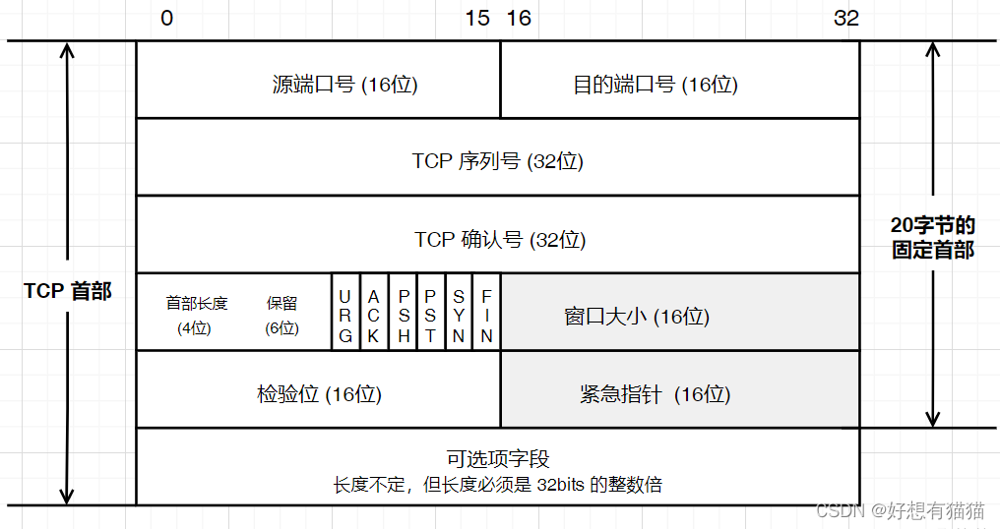
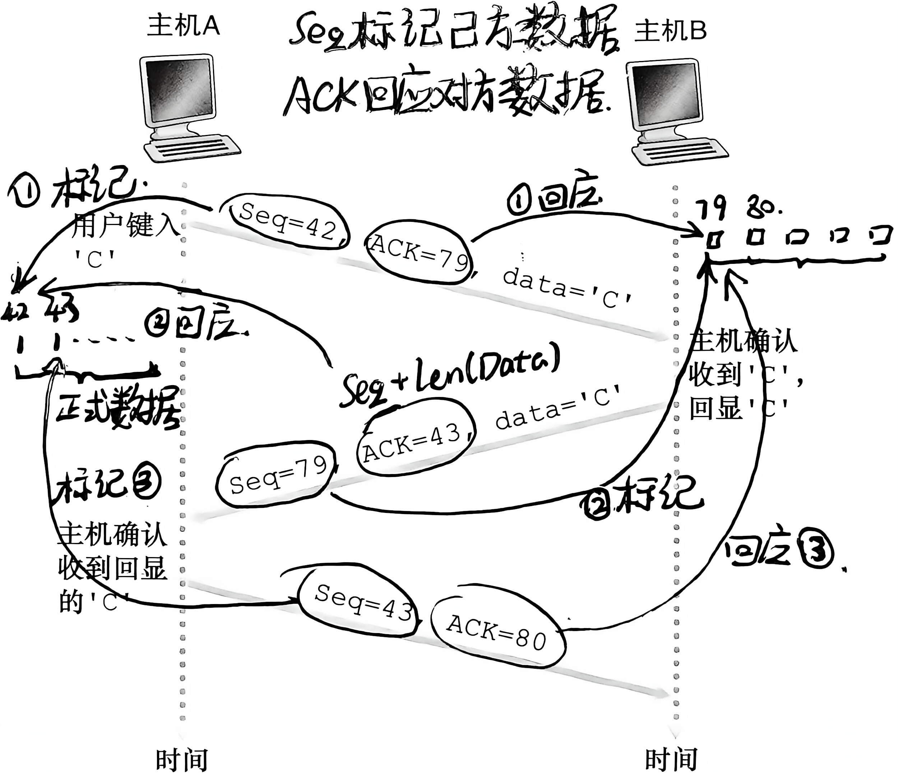
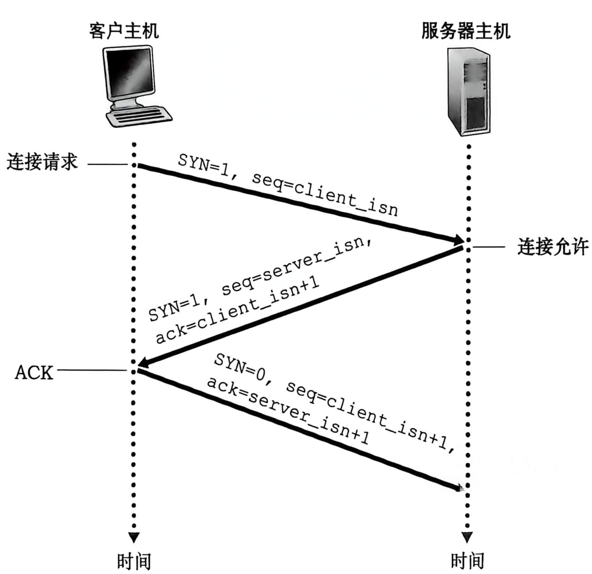

+++
title = "运输层：UDP 与 TCP 原理（下）"
date = 2026-10-03
categories = ["计算机网络"]
tags = ["计算机网络", "TCP", "运输层"]
description = "一篇讲解TCP的原理的文章"
draft = true
+++

---

- [上篇]() 主要讲**前置知识和UDP的工作原理**
- [下篇]() 主要讲**TCP的工作原理**

## 前言

这一篇主要是讲**TCP协议**的原理，关于UDP协议请看[上篇](../transport-layer-UDP/index.md)

## 相关词条

- 网络层
  - IP：Internet Protocol，网际协议  
  它既是一种传输协议，也是定位协议
- 传输层
  - TCP：Transmission Control Protocol，传输控制协议

    - Seq：Sequence Number，序列号
    - Ack：Acknowledgment Number，确认号
    - ISN：Initial Sequence Number，初始序列号

  - UDP：User Datagram Protocol，用户数据报协议
  - MSS：Maximum Segment Size，最大报文段长度
  - MTU：Maximum Transmission Unit，最大传输单元

## TCP报文结构

我们先来了解一下TCP的首部里面主要的字段的含义

### 1. 端口号

> 包含 **源端口号 和 目的端口号**（各为**4字节**长度），这一点和 UDP报文 一样

### 2. TCP序列号(Seq)

> *seq：Sequence Numbe*，这个字段对于后面理解TCP协议的机制特别重要，其意义是：**此报文所发送的一个数据段的第一个字节编号**  
>
> 关于数据段和字节编号后面会涉及到的，这里简单提一嘴：
> TCP在发送的时候，会将数据切成一个个数据端依次发送，数据的每一个字节都会有自己的唯一编号，而在**握手阶段**双方都会告诉对方自己的**ISN**（初始序列号）

### 3. TCP确认号(Ack)

> *Ack：Acknowledgment Number*，这个字段对于后面理解TCP协议的机制同样也是特别重要，其意义是：**确认收到对方发来的前Ack-1个字节，并希望对方从Ack字节开始发送**
>
它和 **Seq** 其实也有一个关系公式：
> *Ack*（接受方发回）= *Seq*（发收方发来）+ *size(数据段)*

### 4.窗口大小

由**发送当前这个的 TCP 报文的那一方**填写，表示它自己的**接收窗口** （rwnd），用于流量控制  
这个字段的含义是这样子的：

> 从本报文的确认号开始，接收方当前还能接收多少字节

目前可以不用过多了解这个字段，我们在后面会提到

### 5.检验位

即所谓的**检验和**（关于检验和可以详见[上篇]()）

### 6.六个标志字段

六个标志字段的大小都是**1位**，分别是**URG、ACK、PSH、RST、SYN、FIN**
当字段值为**0**的时候，表示**未使用**；字段值为**1**的时候，表示**被使用**  
  
- **ACK**：*Acknowledgment*，确认标志（*这里的 ACK和之前的那个确认号不一样的，不要搞混了*）
  被使用时，含义：**己方报文的确认号（Ack）字段有效**
  > 还记的确认号Ack吗：确认发来的前Ack-1个字节，并希望对方从Ack字节开始发送

- **SYN**：*Synchronize*，同步标志  
  被使用时，含义：**己方请求建立连接，并同步初始序列号**，此时的Seq的值将会被用作**ISN**；SYN字段用于**三次握手阶段**

- **FIN**：*Finish*，结束标志
  被使用时，含义：**己方没有更多数据要发送，准备关闭连接**；FIN字段用于**四次挥手阶段**

- **RST**：*Reset*，重置标志
  被使用时，含义：**强制停止当前连接，停止数据发送**

- **PSH**：*Push*，推送标志
  被使用时，含义：**己方希望对方尽快把数据向上交给应用层**

- **URG**：*Urgent*，紧急标志
  被使用时，含义：**己方报文中紧急数据指针有效**（这个在实际中使用很少，所以不多讲了）

而在这篇文章里面，比较重要的就是前三个了：**ACK、SYN、FIN**

### 7.其他字段

包括**首部长度、可选字段、紧急数据指针、可选选项**

---

## 初识TCP的正常传输

我个人觉得，先从 TCP正常传输入手，比从 TCP三次握手开始讲会更加好  
因为 TCP三次握手其实和 TCP正常传输特别像，只是在这个基础上多了一点点东西而已
在这之前，我们需要来了解一些必要的**前置知识**（真的很必要）

### 前置知识

#### 1. TCP是全双工的

这意味着，TCP连接里面**没有绝对的发送方，也没有绝对的接收方**：每一个端系统既可以作为发送方发送数据，也可以作为接收方接收其他的数据——并且，二者可以同时进行

#### 2. TCP协议会把数据拆成一个个数据段进行发送

在正式传输之前，TCP协议会把上层传来的数据（也就是应用层报文）按照一定大小切割成一个个数据段，每一个数据段为一个**最小输送元单位**，并且会按照字节**对每一个字节进行编号**

有了这些基本的知识，我们就可以来看看 TCP的正常工作流程了

### 来吧，传输

在开始讲述传输过程之前，再来回顾一下我们要用到的概念  

- Seq：序列号，是发送方用来标记**此报文所发送的一个数据段的第一个字节编号**
- Ack：确认号，用来**确认收到对方发来的前Ack-1个字节**
- ISN：初始序列号，在**握手阶段**双方会确定对方的ISN，最终发出的第一个报文的 **Seq =ISN+1**（**因为三次握手会消耗一个序列号**），后续的字节编号也是以这个数字作为起点依次递增

在下面这个示例中，我们假定每一个数据段的大小为**1字节**（当然，实际传输过程绝对要大于这个的，这一点后面会提到，也可以自行提前了解一下什么是**MSS**（最大报文段长度））

>注：下图的ACK就是确认号Ack的意思

## TCP的三次握手

了解了TCP的正常工作机制后，就可以来看看握手是怎么个事情了

### 来吧，握手

有了前置知识，我们就可以来了解一下TCP的三次握手流程了

初次看到这个流程图，肯定是十分甚至九分晦涩难懂的，但是不慌，这里我们先再次来回顾一下要用到的概念

- SYN：用在三次握手阶段的Flag标志
